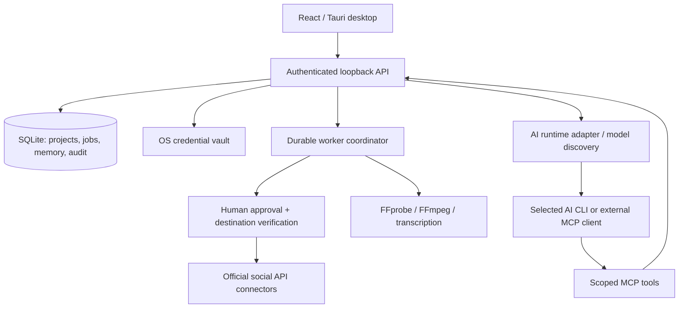

# Architecture — local workspace and planned publishing

Phase 1 implements the React/Tauri desktop, authenticated loopback API, SQLite
accounts/projects/context/memory/audit and a Windows DPAPI vault port. AI, MCP,
media processing, queues, approval and social connectors in the diagram remain
target boundaries. See [local workspace details](LOCAL-WORKSPACE.md).

## Local-first application



Target stack: React + TypeScript, Tauri 2, local Node.js services, SQLite, an OS
credential vault, FFmpeg/FFprobe and the official MCP SDK. FFmpeg and MCP are
future dependencies. SQLite currently uses the API built into the pinned Node
22 runtime, avoiding a separately compiled native addon. Windows native startup,
CRUD and shutdown have been exercised; macOS/Linux desktop packages remain
unverified. Source checks are configured for Windows/Linux CI.

AtrisHub is the ecosystem website. No account, entitlement, hosted storage or
execution dependency on AtrisHub is assumed by this template. Any future
integration needs a separate product decision.

## Account identity and memory

- Give every connected account a stable internal ID and store the provider's
  authenticated subject and exact destination (channel, profile, organization).
- Pass account/project context through API calls, AI sessions, jobs, artifacts
  and memory queries. Never derive it from whichever account is currently selected.
- Before an operation, resolve the account, capability/scopes and permitted
  destination. Re-verify before an external side effect. Revoked permissions or
  a changed destination block the job and request reconnection/review.
- A single OAuth identity may control several destinations; model them explicitly.
- Store future social credentials in the OS vault; SQLite must hold references,
  not token values. Current demo accounts have no social credentials. The DPAPI
  port is internal and not exposed through HTTP or frontend IPC. Unsupported or
  unavailable vaults fail closed; there is no plaintext fallback.
- Store brand voice, audience, edit history and publication receipts as scoped
  memory with provenance. AI suggestions remain distinguishable from confirmed
  preferences. Let users inspect, correct, export and delete this context.
- Previous memory is context, never permission to publish or change accounts.

## Media and AI

Keep source media immutable. Store revisioned timeline operations and generated
artifacts separately. Manual actions and AI proposals share validated timeline
operations, with preview, accept/reject and undo behavior. A proposal based on
an older timeline revision cannot silently replace newer edits.

Clip discovery uses timestamped transcripts and, when available, scene/audio
and visual signals. Candidates include boundaries, evidence and a rationale;
target duration is configurable (30 seconds is an example, not a universal limit).
Users choose candidates, inspect framing/captions and render a final artifact.
Channel metadata and prior edit history may inform suggestions, but raw footage
must be available through an authorized source. Channel listing is not downloading.

The AI bridge separates runtime installation/auth/model discovery/session events
from media operations. Reuse AtrisAgent patterns after isolating their coupling;
do not copy its workspace manager or orchestration stack wholesale.

MCP tools expose inspection, transcription, clip suggestions, edit proposals,
preview renders, draft preparation and approval requests. They validate input,
enforce account/project/artifact scope and support cancellation. No tool accepts
arbitrary shell commands, reads the credential vault, approves or publishes.
Workspace runtime schemas and scope checks are implemented. Media/publishing
contracts alone do not enforce the future MCP/publishing rules.

## Publication lifecycle

Every destination is a separate immutable publication intent and job. Canonical
payload serialization/digesting must cover account, platform, destination,
text/title, visibility, schedule, metadata and every media artifact hash/revision.
The exact schema and canonicalization will be completed before live publication.

1. Validate the draft against current connector capabilities.
2. Snapshot the payload and account/destination. Create a durable job.
3. At dispatch time (immediately or when a scheduled occurrence becomes due),
   notify the user and enter `awaiting-approval`.
4. Show account identity, destination, final media/text/metadata, visibility and
   planned time. A trusted UI records an explicit user decision with an expiry.
5. For an approved job, recheck identity, scopes, payload digest, artifact hashes,
   approval expiry/revocation and worker ownership immediately before sending.
   Consume the approval transactionally so competing workers cannot reuse it.
6. Record the provider receipt and audit event, or a classified failure.

Editing a payload, replacing media, changing its schedule or switching its target
invalidates approval. Rejection/cancellation prevents dispatch. AI cannot create
an approval by returning a tool result or setting a field on a request.

```text
scheduled -> awaiting-approval -> ready -> publishing -> published
                  |                |          |
          rejected / expired       |      reconciling -> published / failed
                                   +-> expired / failed
non-terminal work -> cancelled (provider-specific cancellation limits apply)
```

An upload/processing step that creates externally visible state also needs an
appropriate approval boundary. Platform-specific multi-stage uploads, posts and
processing polling must document where irreversible effects occur.

## Scheduling, recovery and duplicate prevention

- Store the IANA time zone and local recurrence rule alongside each computed UTC
  occurrence. Define DST-gap/overlap behavior explicitly before implementation.
- Each daily/weekly occurrence gets its own intent, job and approval. Creating a
  recurring schedule does not authorize future publication without confirmation.
- At the due time, notify and wait. Missed/expired occurrences use an explicit
  skip-or-ask policy, never silent catch-up. Approval after a missed time must
  clearly show the actual dispatch timing and may require a new snapshot.
- Local scheduling needs a running process. Desktop/tray/background ownership,
  sleep/resume and app-offline behavior must be visible; no always-on promise.
- Use persistent jobs, transactional leases/fencing and bounded retries with
  per-account/platform rate limits. Idempotency keys identify each occurrence.
- On an ambiguous provider timeout, reconcile receipts/upload state before retry.
  Provider APIs may not support exactly-once semantics; local deduplication alone
  cannot guarantee it. Cross-post partial failures stay visible per destination.

## Validation milestones

Before live publishing: account isolation, stale/replayed approval, identity
mismatch, expired/revoked token, duplicate worker and ambiguous-timeout tests.
Before scheduling: restart, DST, sleep/offline, missed occurrence, cancellation
and per-occurrence confirmation tests. Before release: native desktop rendering,
notification flow, clean-machine packaging and authorized test-account evidence.
