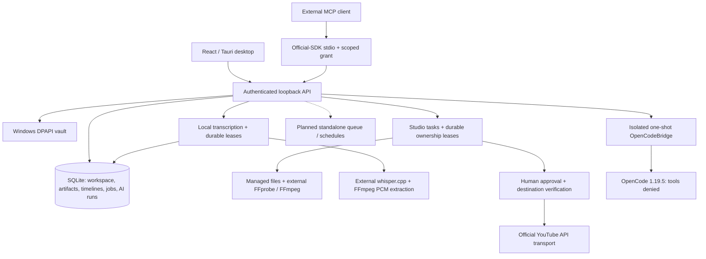

# Architecture — local workspace, Studio, AI proposals and supervised publishing

Phase 1 implements the React/Tauri desktop, authenticated loopback API, SQLite
accounts/projects/context/memory/audit and a Windows DPAPI vault port. Phase 2 code
adds YouTube OAuth/PKCE, subject/channel verification, refresh/disconnect, owned
catalog/linking, managed media, approval, resumable upload and receipt/reconciliation.
Provider tests are controlled, not live Google. Live connection/publication acceptance
is deferred to Phase 9 and requires a user-owned OAuth app, authorized channel and human approval.
Phase 3's limited manual editor is implemented, including split/kept ranges and
full-source proxies. Phase 4 core feature implementation is complete: the required
first real OpenCode adapter, scoped stdio MCP, local timestamped transcription and
explicit transcript disclosure consent. Additional CLI adapters are future extensions;
automated clip analysis belongs to Phase 5. Multi-track/timed captions, standalone
queues and scheduling are not implemented. Live AI and all-feature end-to-end
acceptance for Phases 0–8 are consolidated at final Phase 9 after Phase 8 hardening,
packaging and feature completion; local checks continue as engineering evidence.
See [local workspace details](LOCAL-WORKSPACE.md) and [YouTube](YOUTUBE.md).

## Local-first application



Current stack: React + TypeScript, Tauri 2, local Node.js services, SQLite, Windows
DPAPI, external FFmpeg/FFprobe and official MCP SDK 1.32.2 stdio. SQLite uses the API built into
the pinned Node 22 runtime, avoiding a separately compiled native addon. Windows native startup,
CRUD and shutdown have been exercised; macOS/Linux desktop packages remain
unverified. Source checks are configured for Windows/Linux CI.

Studio, YouTube, transcription and AI proposal orchestration currently live in `services/local-api`; the
`services/worker` directory reserves the future standalone queue boundary. Windows
uses a custom titlebar and starts Node suspended inside a kill-on-close Job Object
before resuming it. The job owns Node and its media descendants; native closure or
owner termination kills that tree. Local tasks stop on close, with no tray/background
or always-on scheduler. Remote effects already accepted cannot be rolled back by
stopping a process.

AtrisHub is the ecosystem website. No account, entitlement, hosted storage or
execution dependency on AtrisHub is assumed by this template. Any future
integration needs a separate product decision.

## Account identity and memory

- Give every connected account a stable internal ID and store the provider's
  authenticated subject and exact destination (channel, profile, organization).
- Pass account/project context through API calls, AI sessions, jobs, artifacts
  and memory queries. Never derive it from whichever account is currently selected.
- Before an operation, resolve the account, capability/scopes and permitted
  destination. Re-verify before an external side effect. Revoked permissions or
  a changed destination block the job and request reconnection/review.
- A single OAuth identity may control several destinations; model them explicitly.
- Store social credentials in the OS vault; SQLite must hold references,
  not token values. Current demo accounts have no social credentials. The DPAPI
  port is internal and not exposed through HTTP or frontend IPC. Unsupported or
  unavailable vaults fail closed; there is no plaintext fallback.
- Store brand voice, audience, edit history and publication receipts as scoped
  memory with provenance. AI suggestions remain distinguishable from confirmed
  preferences. Let users inspect, correct, export and delete this context.
- Previous memory is context, never permission to publish or change accounts.

Accounts' YouTube setup saves the Desktop app client ID and optional secret under
a reserved DPAPI vault reference, separate from account grants. It activates
immediately and reloads before API startup; valid local configuration takes precedence
over the environment fallback. Invalid/unreadable saved configuration fails closed.
Only safe readiness/source/errors are returned, with no credential readback or browser
storage. Configuration writes and active OAuth sessions are mutually fenced. Existing
connected-account grants keep their original client configuration for refresh/revoke.

## Media and AI

### Implemented limited manual editor (Phase 3)

Managed import streams up to **2 GiB**, validates self-contained MP4-family or WebM
content and records SHA-256/bytes/MIME. Accepted names are `.mp4`, `.mov`, `.webm`
and `.mkv`; `.mkv` still requires WebM content, not general Matroska. Container
inspection rejects playlists/external references before demuxing. Immutable UUID
files are published exclusively; generated exports get separate artifacts.
Authenticated Blob preview/download is capped at **256 MiB**, with no bearer URLs
and WebView-dependent codec support. SQLite and media are not encrypted; vault
records alone use DPAPI.

The manual editor persists an outer source envelope and optional **1–32 ordered,
non-overlapping kept ranges** within its bounds. Trim/split/remove use source seconds;
real FFmpeg concat removes gaps and sums kept durations. Video/audio subtract the
same source origin, with silence padding for missing audio intervals, including
offset audio. Sources without audio remain silent without a synthesized audio stream.
Centered original/vertical/square crop, static caption and gain apply globally.
Save/undo/redo use optimistic revision CAS and branch replacement; reopening loads
the saved cursor/history. Export captures a saved revision and reports progress/
cancellation; retry starts a new export. Expired running-render leases surface
interruption, not automatic resume. Multi-track and timed captions are absent.

Full-source compatible proxies are separate source/hash-linked artifacts, H.264/
yuv420p + AAC when audio exists, at most **1280×720** without upscaling. Rotation
is applied and display aspect preserved, including anamorphic media. Playback keeps
the full shared A/V clock and source duration, independent of edits; switching source/
proxy retains source time. The player shows stored bytes, not live unsaved edits.
Proxy and proposal-preview artifacts are not publication artifacts.
Successful exports and publications add scoped history notes.

External executables resolve from `ATRIS_SHARE_FFMPEG` / `ATRIS_SHARE_FFPROBE` or
`PATH`. Argument arrays, restricted environment/protocols, bounded process output
and timeouts avoid a shell or network demuxing. Export uses H.264 `libx264`, AAC
when audio exists, and static caption text files with `drawtext`. No FFmpeg/FFprobe
binary is bundled. Temporary GPL-enabled verification tools are not distribution
artifacts; redistribution remains a separate build/codec licensing decision.

### Local speech transcription (Phase 4)

`TranscriptionEngine` runs an external whisper.cpp `whisper-cli` selected by
`ATRIS_SHARE_WHISPER_CLI` (otherwise `PATH`) with an absolute local GGML model path
in `ATRIS_SHARE_WHISPER_MODEL`. No tool/model download or bundling is performed.
FFmpeg extracts **16 kHz mono 16-bit PCM** in a temporary workspace; source/decoded
audio over **two hours** is rejected, not silently truncated. The engine validates
language and ordered segment timestamps against decoded audio duration. Raw CLI
diagnostics/paths are not exposed as transcript fields; temporary audio/JSON is removed.

`TranscriptionService` verifies actual managed source bytes against SHA-256 before
and after processing. `TranscriptStore` persists account/project/artifact/hash-bound,
sanitized text, progress and cancellation in SQLite (not encrypted). A workspace-wide
claim and five-minute heartbeat-renewed owner lease fence competing/stale workers.
Cancellation is durable across runtimes; expired running leases surface
`transcript_interrupted`. No automatic retry/resume occurs; another attempt is explicit.
Speech remains local until an explicit AI request or MCP grant opts into transcript
disclosure. Memory consent is separate.

### AI bridge and MCP (Phase 4 core implemented)

`OpenCodeBridge` discovers a native executable safely; currently only verified
**1.19.5** is allowed, with other versions failing closed. CLI authentication stays
CLI-owned: the auth-store path is preserved, credentials never read/copied by
AtrisShare. Fresh temporary cwd/home/config/cache/state/database isolate each call.
Effective config and resolved agent permissions are verified before model listing/
generation, denying files, tools, skills, plugins and MCP in the child. Cancellation
kills/awaits the owned tree before temporary state/transcript cleanup. CLI calls
are one-shot, never resumed. See [bridge details](../packages/ai-bridge/README.md).

The user selects an actual CLI-returned model ID; discovery is not entitlement
proof. Generate sends request text, scoped metadata/source probe and current
timeline plus optional confirmed account/project memory. `includeTranscript` defaults
to false and is an explicit prompt checkbox, independent of memory opt-in. When
enabled, the API checks actual source bytes and includes a successful hash-bound
transcript capped at **16,000 text characters / 150 segments**, with language,
duration, source hash and `truncated` metadata. **No media bytes, frames or audio
are sent.** Local AtrisShare run/proposal history persists after CLI
transcript removal. Proposals are immutable and bound to scope, source SHA-256 and
base revision. Humans can preview and accept/reject; only acceptance mutates the
timeline. Acceptance verifies hash/revision and uses the manual timeline/undo path;
stale proposals cannot overwrite newer edits. Cancellation requests are durable
across runtimes, with ownership/heartbeat fencing and no session resume.

External MCP clients use official SDK **1.32.2** stdio with a **separate UI-minted
30-minute capability** bound to artifact/account/project/destination, with separate
confirmed-memory and transcript-read opt-ins. The UI returns actual command/args and `ATRIS_SHARE_MCP_ORIGIN` /
`ATRIS_SHARE_MCP_GRANT` environment config. Grants expire, can be revoked and are
invalidated by runtime restart; the desktop bearer is never supplied externally.
Only `/api/mcp/*` accepts the grant. Strict calls expose `media_inspect`,
`timeline_read`, optional `memory_read`, `timeline_propose`, `render_preview`,
`render_status` and `publication_request` (review draft only), plus local
`media_transcribe`, `transcript_status` and `transcript_cancel`. These transcription
control responses contain metadata and empty segments, never speech text.
`transcript_read` is advertised/allowed only with transcript opt-in, checks actual
source bytes against the hash and paginates segments using integer `offset`/`limit`
(maximum 100). Without consent, a grant cannot retrieve speech text. Cancellation
is restricted to grant-tracked transcript jobs; previews/renders remain grant-owned.
There is no approve or publish tool. See [launch and packaging](../services/mcp-server/README.md).

Prior local Windows native checks discovered nine routes from installed OpenCode
1.19.5 and exercised external-SDK deterministic proposal/preview/human apply/manual
undo with unchanged source bytes. No live LLM inference or YouTube acceptance was
performed, and no secrets were provided. These are local engineering checks, not
final Phase 9 acceptance or a reason to mark Phase 4 core incomplete. Additional CLI
adapters are future extensions. Future clip discovery needs timestamped
transcript/scene/audio evidence and explained candidates. Channel listing still
does not supply source footage or downloading rights.

## Publication lifecycle

The implemented YouTube version-1 payload has fixed-order canonical serialization
and a SHA-256 digest binding account/project/destination, artifact ID/hash/bytes/MIME,
title, description, visibility, made-for-kids and subscriber-notification settings.
There is no schedule field or mutable payload endpoint; changes require a new draft.

1. Verify the scoped artifact hash and create an immutable `review` record.
2. Show destination, media/hash, metadata and digest in the trusted review UI.
3. An explicit human approval transaction checks the digest, consumes `review`
   once, sets a **10-minute dispatch window** and claims a durable owner lease.
4. Refresh/re-verify Google subject, scopes and exactly one matching channel.
   Fence changed connections and recheck lease, expiry and dispatch revocation
   immediately before initiation/chunks. Upload a temporary hash-verified byte snapshot.
5. Encrypt the resumable session URL in the vault; persist only its reference in
   SQLite. Checkpoint progress/video ID under the five-minute lease with heartbeat.
6. A final provider ID enters `processing`; explicit processing success creates a
   durable success receipt, then optional scoped publication memory.

No AI/MCP approval path exists. The runtime bearer represents the trusted local
session, not a separate human identity; its approve route must only be used after
the human review. Account connection and memory content never authorize dispatch.

```text
review -> uploading -> processing -> succeeded / failed
   |          |
cancelled  uncertain -> reconcile existing session / recorded video
```

Upload initiation itself is approval-gated. An expired owner appears interrupted/
uncertain. Reconciliation queries existing remote state; it may send remaining
bytes only while the original approval remains valid and unrevoked. Missing or
unrecorded sessions never cause blind re-initiation. There are no automatic
transport retries or exactly-once guarantees.

Review cancellation prevents approval. Uploading/uncertain cancellation persists
dispatch revocation and aborts local work; later status reconciliation cannot
authorize more bytes. In-flight/already accepted remote effects cannot be promised
undone. Processing/terminal cancellation is rejected; there is no delete/unpublish
operation. Session URL allowlists, redirect rejection, bounded provider JSON and
fixed error codes keep credentials/provider bodies out of frontend responses.

## Scheduling, recovery and duplicate prevention

Scheduling and the general worker queue below are planned. Current Studio leases
provide publication/render ownership, not a recurring scheduler.

- Store the IANA time zone and local recurrence rule alongside each computed UTC
  occurrence. Define DST-gap/overlap behavior explicitly before implementation.
- Each daily/weekly occurrence gets its own intent, job and approval. Creating a
  recurring schedule does not authorize future publication without confirmation.
- At the due time, notify and wait. Missed/expired occurrences use an explicit
  skip-or-ask policy, never silent catch-up. Approval after a missed time must
  clearly show the actual dispatch timing and may require a new snapshot.
- Local scheduling needs a running process. Desktop/tray/background ownership,
  sleep/resume and app-offline behavior must be visible; no always-on promise.
- Use persistent jobs, transactional leases/fencing and bounded retries with
  per-account/platform rate limits. Idempotency keys identify each occurrence.
- On an ambiguous provider timeout, reconcile receipts/upload state before retry.
  Provider APIs may not support exactly-once semantics; local deduplication alone
  cannot guarantee it. Cross-post partial failures stay visible per destination.

## Validation milestones

Controlled tests cover account isolation, stale/replayed approval, identity
mismatch, expired/revoked approval, duplicate claims and ambiguous-upload recovery.
Local regressions, builds and rendered/native UI checks continue during implementation.
The final [Phase 9 matrix](ACCEPTANCE.md) covers all Phase 0–8 features, including
live AI/YouTube, restart/DST/sleep/offline recovery, per-occurrence confirmation,
native cleanup and clean-machine installation. No live OAuth/inference tests were
run; controlled tests are not live provider evidence. Phase 8 completes hardening,
packaging and features first. Release authorization requires Phase 9 completion and
a separate explicit request, never an automatic earlier release.
