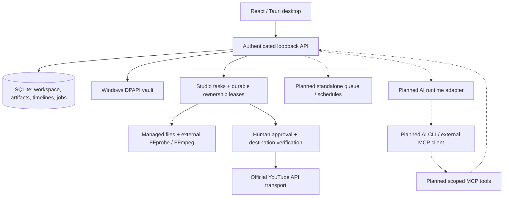

# Architecture — local workspace, Studio and supervised publishing

Phase 1 implements the React/Tauri desktop, authenticated loopback API, SQLite
accounts/projects/context/memory/audit and a Windows DPAPI vault port. Phase 2 code
adds YouTube OAuth/PKCE, subject/channel verification, refresh/disconnect, owned
catalog/linking, managed media, approval, resumable upload and receipt/reconciliation.
Provider tests are controlled, not live Google. Live connection/publication acceptance
is pending and requires a user-owned OAuth app, authorized channel and human approval.
Phase 3 is a partial single-clip editor. AI/MCP, multi-track/split/proxies, standalone
queues and scheduling remain planned.
See [local workspace details](LOCAL-WORKSPACE.md) and [YouTube](YOUTUBE.md).

## Local-first application



Current stack: React + TypeScript, Tauri 2, local Node.js services, SQLite, Windows
DPAPI and external FFmpeg/FFprobe. MCP is planned. SQLite uses the API built into
the pinned Node 22 runtime, avoiding a separately compiled native addon. Windows native startup,
CRUD and shutdown have been exercised; macOS/Linux desktop packages remain
unverified. Source checks are configured for Windows/Linux CI.

Studio and YouTube orchestration currently live in `services/local-api`; the
`services/worker` directory reserves the future standalone queue boundary. Windows
uses a custom titlebar and starts Node suspended inside a kill-on-close Job Object
before resuming it. The job owns Node and its media descendants; native closure or
owner termination kills that tree. Local tasks stop on close, with no tray/background
or always-on scheduler. Remote effects already accepted cannot be rolled back by
stopping a process.

AtrisHub is the ecosystem website. No account, entitlement, hosted storage or
execution dependency on AtrisHub is assumed by this template. Any future
integration needs a separate product decision.

## Account identity and memory

- Give every connected account a stable internal ID and store the provider's
  authenticated subject and exact destination (channel, profile, organization).
- Pass account/project context through API calls, AI sessions, jobs, artifacts
  and memory queries. Never derive it from whichever account is currently selected.
- Before an operation, resolve the account, capability/scopes and permitted
  destination. Re-verify before an external side effect. Revoked permissions or
  a changed destination block the job and request reconnection/review.
- A single OAuth identity may control several destinations; model them explicitly.
- Store social credentials in the OS vault; SQLite must hold references,
  not token values. Current demo accounts have no social credentials. The DPAPI
  port is internal and not exposed through HTTP or frontend IPC. Unsupported or
  unavailable vaults fail closed; there is no plaintext fallback.
- Store brand voice, audience, edit history and publication receipts as scoped
  memory with provenance. AI suggestions remain distinguishable from confirmed
  preferences. Let users inspect, correct, export and delete this context.
- Previous memory is context, never permission to publish or change accounts.

## Media and AI

### Implemented single-clip slice

Managed import streams up to **2 GiB**, validates self-contained MP4-family or WebM
content and records SHA-256/bytes/MIME. Accepted names are `.mp4`, `.mov`, `.webm`
and `.mkv`; `.mkv` still requires WebM content, not general Matroska. Container
inspection rejects playlists/external references before demuxing. Immutable UUID
files are published exclusively; generated exports get separate artifacts.
Authenticated Blob preview/download is capped at **256 MiB**, with no bearer URLs
and WebView-dependent codec support. SQLite and media are not encrypted; vault
records alone use DPAPI.

The manual editor persists a single clip's trim, centered original/vertical/square
crop, static caption and gain. Save/undo/redo use optimistic revisions; reopening
loads the saved cursor/history. Export captures a saved revision and reports
progress/cancellation; retry starts a new export. Expired running-render leases
surface interruption, not automatic resume. The player shows stored source/export
bytes, not a live preview of unsaved edits. Multi-track, split and proxies are absent.
Successful exports and publications add scoped history notes.

External executables resolve from `ATRIS_SHARE_FFMPEG` / `ATRIS_SHARE_FFPROBE` or
`PATH`. Argument arrays, restricted environment/protocols, bounded process output
and timeouts avoid a shell or network demuxing. Export uses H.264 `libx264`, AAC
when audio exists, and static caption text files with `drawtext`. No FFmpeg/FFprobe
binary is bundled. Temporary GPL-enabled verification tools are not distribution
artifacts; redistribution remains a separate build/codec licensing decision.

### Planned AI extension

Manual edits and future AI proposals should share validated timeline operations,
with preview, accept/reject and undo behavior. A proposal based on an older revision
must not silently replace newer edits.

Clip discovery uses timestamped transcripts and, when available, scene/audio
and visual signals. Candidates include boundaries, evidence and a rationale;
target duration is configurable (30 seconds is an example, not a universal limit).
Users choose candidates, inspect framing/captions and render a final artifact.
Channel metadata and prior edit history may inform suggestions, but raw footage
must be available through an authorized source. Channel listing is not downloading.

The AI bridge separates runtime installation/auth/model discovery/session events
from media operations. Reuse AtrisAgent patterns after isolating their coupling;
do not copy its workspace manager or orchestration stack wholesale.

MCP tools expose inspection, transcription, clip suggestions, edit proposals,
preview renders, draft preparation and approval requests. They validate input,
enforce account/project/artifact scope and support cancellation. No tool accepts
arbitrary shell commands, reads the credential vault, approves or publishes.
Workspace/media runtime schemas and scope checks are implemented; an MCP server
and its AI authorization boundary are not implemented.

## Publication lifecycle

The implemented YouTube version-1 payload has fixed-order canonical serialization
and a SHA-256 digest binding account/project/destination, artifact ID/hash/bytes/MIME,
title, description, visibility, made-for-kids and subscriber-notification settings.
There is no schedule field or mutable payload endpoint; changes require a new draft.

1. Verify the scoped artifact hash and create an immutable `review` record.
2. Show destination, media/hash, metadata and digest in the trusted review UI.
3. An explicit human approval transaction checks the digest, consumes `review`
   once, sets a **10-minute dispatch window** and claims a durable owner lease.
4. Refresh/re-verify Google subject, scopes and exactly one matching channel.
   Fence changed connections and recheck lease, expiry and dispatch revocation
   immediately before initiation/chunks. Upload a temporary hash-verified byte snapshot.
5. Encrypt the resumable session URL in the vault; persist only its reference in
   SQLite. Checkpoint progress/video ID under the five-minute lease with heartbeat.
6. A final provider ID enters `processing`; explicit processing success creates a
   durable success receipt, then optional scoped publication memory.

No AI/MCP approval path exists. The runtime bearer represents the trusted local
session, not a separate human identity; its approve route must only be used after
the human review. Account connection and memory content never authorize dispatch.

```text
review -> uploading -> processing -> succeeded / failed
   |          |
cancelled  uncertain -> reconcile existing session / recorded video
```

Upload initiation itself is approval-gated. An expired owner appears interrupted/
uncertain. Reconciliation queries existing remote state; it may send remaining
bytes only while the original approval remains valid and unrevoked. Missing or
unrecorded sessions never cause blind re-initiation. There are no automatic
transport retries or exactly-once guarantees.

Review cancellation prevents approval. Uploading/uncertain cancellation persists
dispatch revocation and aborts local work; later status reconciliation cannot
authorize more bytes. In-flight/already accepted remote effects cannot be promised
undone. Processing/terminal cancellation is rejected; there is no delete/unpublish
operation. Session URL allowlists, redirect rejection, bounded provider JSON and
fixed error codes keep credentials/provider bodies out of frontend responses.

## Scheduling, recovery and duplicate prevention

Scheduling and the general worker queue below are planned. Current Studio leases
provide publication/render ownership, not a recurring scheduler.

- Store the IANA time zone and local recurrence rule alongside each computed UTC
  occurrence. Define DST-gap/overlap behavior explicitly before implementation.
- Each daily/weekly occurrence gets its own intent, job and approval. Creating a
  recurring schedule does not authorize future publication without confirmation.
- At the due time, notify and wait. Missed/expired occurrences use an explicit
  skip-or-ask policy, never silent catch-up. Approval after a missed time must
  clearly show the actual dispatch timing and may require a new snapshot.
- Local scheduling needs a running process. Desktop/tray/background ownership,
  sleep/resume and app-offline behavior must be visible; no always-on promise.
- Use persistent jobs, transactional leases/fencing and bounded retries with
  per-account/platform rate limits. Idempotency keys identify each occurrence.
- On an ambiguous provider timeout, reconcile receipts/upload state before retry.
  Provider APIs may not support exactly-once semantics; local deduplication alone
  cannot guarantee it. Cross-post partial failures stay visible per destination.

## Validation milestones

Controlled tests cover account isolation, stale/replayed approval, identity
mismatch, expired/revoked approval, duplicate claims and ambiguous-upload recovery.
Live connection/publication acceptance still needs the user's OAuth app, authorized
channel and explicit human review; controlled tests are not live Google evidence.
Before scheduling: restart, DST, sleep/offline, missed occurrence, cancellation
and per-occurrence confirmation tests. Before release: native desktop rendering,
notification flow, clean-machine packaging and authorized test-account evidence.
